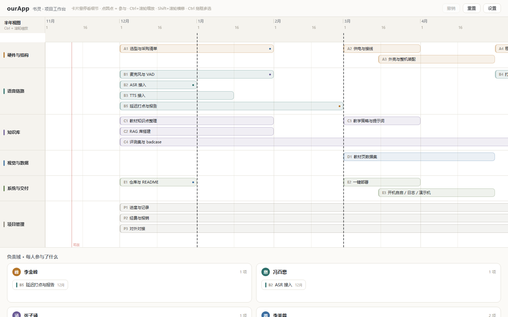
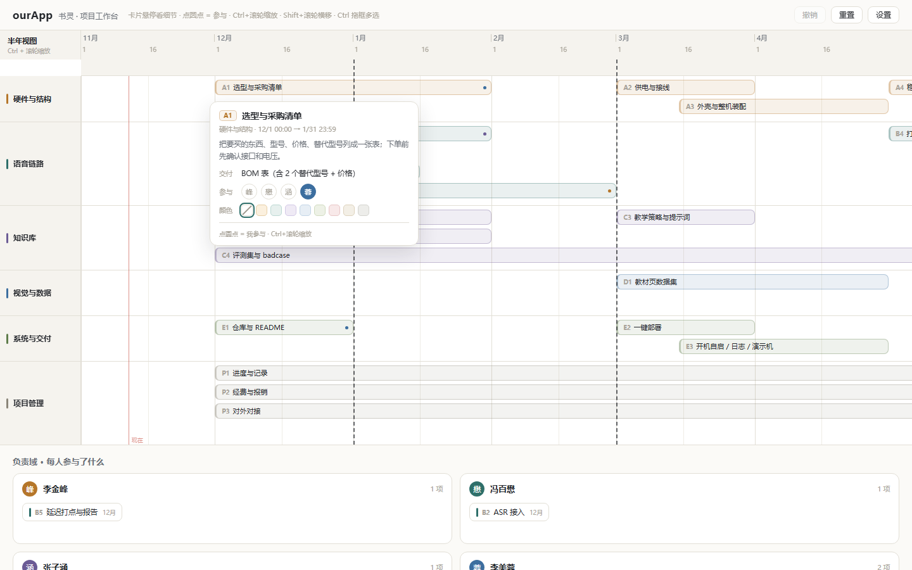
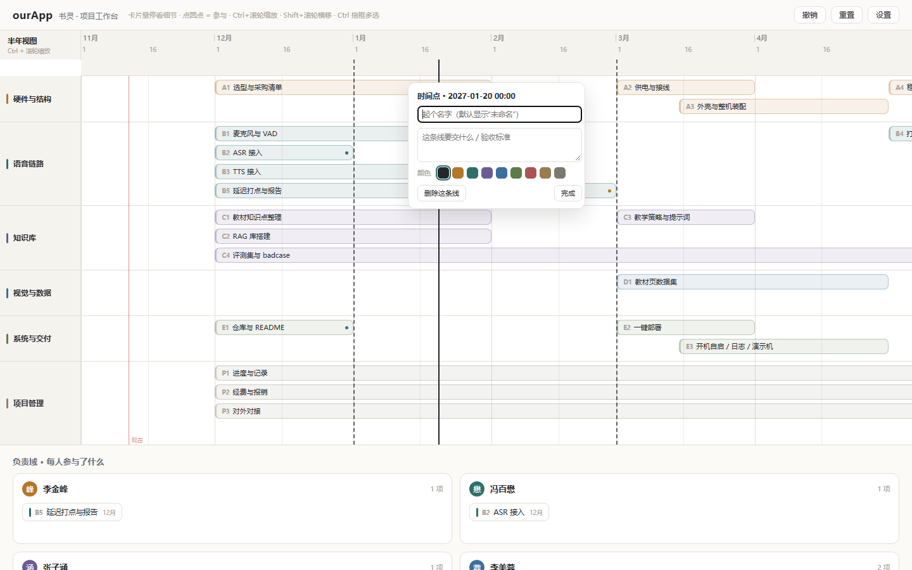

# 书灵 · 桌面 AI 学伴机器人

卓越班科创活动 · 项目 5 ｜ 2026.12 – 2027.11 ｜ 4 人 ｜ 电气工程

这个仓库不只是代码，它是这个项目的**全部现场**：计划、看板、代码、每个人的实验田、每次验收的记录，都在这里。
规则只有一条：**所有人的东西都对所有人可见，但只改自己的。**



---

## 1. 先找到你自己的位置

```
├─ proj/            ← 正式工程。能跑的东西才进这里
├─ users/           ← 每个人的工作区（只改自己那一格）
│   ├─ 李金峰/
│   ├─ 冯百懋/
│   ├─ 张子涵/
│   └─ 李美蓉/
├─ docs/            ← 设计与规则文档
├─ tools/           ← 零碎小工具（画图脚本等）
└─ 卓越班科创活动项目申请表(2).docx
```

| 文件夹 | 是什么 | 你能改吗 |
|---|---|---|
| `proj/ourApp` | 公共工作台（时间线 / 参与 / 负责域），带 CLI | 跑通了才搬进来，平时别直接改 |
| `users/<你的名字>` | 你的实验田：工程副本、笔记、半成品 | **只能改自己的** |
| `docs/` | 项目基线、交互设计、配色、分工 | 提建议，别自己改 |
| `tools/` | 画图之类的小脚本 | 可以加 |

**你的工作指南在 `users/<你的名字>/工作指南.md`** —— 里面写了你负责哪条线、这周做什么、怎么跑、怎么搬回来。先读那个。

---

## 2. 打开工作台（不用装任何东西）

双击 **`proj/ourApp/dist/ourApp.html`**。

它是打包好的单文件，React、样式、数据全在一个 HTML 里，双击就能用，不需要服务器、不需要 Node。
发给别人也是发这一个文件。

> 数据存在浏览器本地（localStorage），换电脑不同步。要同步就导出 JSON 再导入。

---

## 3. 五分钟上手

### ① 看全局

上面是时间线：6 条主线并行，每张卡片是一个子任务。
竖着的黑色虚线是**验收节点**，拖到哪就是哪。

### ② 把鼠标放到卡片上



弹出详情：干什么、要交什么、四个圆点（谁参与）、颜色。
**点圆点 = 我参与**，下面「负责域」里立刻出现这张卡。

### ③ 在带子里点一下 = 加一个验收节点



表头下面那条带子，点一下就在那个刻度上生成一条竖线，并直接打开编辑器：名字、备注、颜色、删除。

### ④ 拖

- 按住卡片直接拖（超过 3px 才起拖），卡片跟着鼠标走，**松手才吸附**到刻度
- 拖卡片右边缘 = 改时长
- 拖左上角的主线名区域 = 调主任务顺序（`▲▼`）
- `Ctrl + 滚轮` = 缩放（年 / 半年 / 季 / 月 / 半月 / 周 / 日）
- `Shift + 滚轮` = 左右移动
- `Ctrl + 拖框` = 多选；`Delete` 删除；`Ctrl+Z` 撤销

### ⑤ 锁定

卡片悬停，右上角出现图钉，点一下就锁住——**锁住的任务不能拖、不能改时长**。
批量锁定在底部浮条上，一个图钉键：全锁 / 全解锁。

---

## 4. 自己动手改代码（可选）

只有想改界面/交互时才需要。**只想看看的话，第 2 节就够了。**

### 装环境（一次）

- Node.js ≥ 20
- pnpm ≥ 9

```bash
node -v && pnpm -v
```

### 开发

```bash
cd proj/ourApp
pnpm install
pnpm dev          # 浏览器打开 http://localhost:5173
```

改 `src/` 里的文件，浏览器会热更新。

### 打包

```bash
node build.mjs    # 生成 dist/ourApp.html
```

> 打包脚本会把 `index.html` 自动改名成 `ourApp.html`，别手动改。

### 目录

```
proj/ourApp/
├─ src/
│  ├─ model/       time.js（刻度）  board.js（数据与操作）  notes.js  colors.js
│  ├─ state/       useBoard.js（唯一写入口 + 撤销 + 本地存储）
│  └─ components/  Timeline  TaskDetail  DutyZone  BatchBar  MarkEditor  Toolbar
├─ data/board.json 看板数据（CLI 和网页共用这一份）
├─ cli.mjs         命令行
├─ build.mjs       打包 + 改名
└─ dist/ourApp.html 打包产物（提交进仓库，别人直接双击用）
```

---

## 5. 命令行

不想用鼠标时用，改的是 `data/board.json`：

```bash
node cli.mjs list                          # 所有任务
node cli.mjs groups                        # 所有主线
node cli.mjs show A1                       # 一个任务
node cli.mjs who 2                         # 2 号参与了什么

node cli.mjs task add --group D --name "标注第一批" --start 2027-03-02 --end 2027-03-16
node cli.mjs task set A2 --start 2027-03-05 --color c4 --pin
node cli.mjs task rm A2

node cli.mjs group set A --name "硬件" --color "#B5762A" --collapse
node cli.mjs group move A up

node cli.mjs duty A2 +2 +3                 # 加参与人
node cli.mjs mark ls                       # 验收节点
node cli.mjs mark add --at 2027-03-15T18:00 --name "中期检查"
node cli.mjs check                         # 检查数据有没有坏
```

网页里改的数据，用「设置 → 导出」存成 `board.json`，覆盖 `data/board.json` 就能让 CLI 接手；反过来用「导入」。

---

## 6. 协作规则

1. **改自己的**：`users/<你>/`。想怎么试都行，坏了不影响别人。
2. **跑通才搬**：确认能用，再整块搬到 `proj/`，然后在群里说一句「我改了 X，搬进 proj 了」。
3. **搬之前自检**：`node cli.mjs check` 通过、`node build.mjs` 通过、双击 `dist/ourApp.html` 能开。
4. **看别人的可以，改别人的不行**。
5. **不要提交** `node_modules/`；**不要写**密码和 key。

搬运命令（Windows）：

```bash
robocopy ..\..\proj\ourApp .\ourApp /E /XD node_modules   # 拉一份到自己这
robocopy .\ourApp ..\..\proj\ourApp /E /XD node_modules   # 改好了搬回去
```

---

## 7. 第一次拿到这个仓库

```bash
git clone git@github.com:<你的账号>/<仓库名>.git
cd <仓库名>
```

SSH 没配过的话，见 [`docs/08-GitHub接入.md`](docs/08-GitHub接入.md)。

---

## 8. 文档

| 文件 | 内容 |
|---|---|
| [docs/00-项目基线](docs/00-项目基线.md) | 目标、边界、验收判据、风险 |
| [docs/05-系统设计](docs/05-系统设计.md) | 对象模型、文件布局、同步协议 |
| [docs/06-交互设计](docs/06-交互设计.md) | 每个交互怎么定义、优先级 |
| [docs/07-配色系统](docs/07-配色系统.md) | 主题色、卡片色、深色模式 |
| [docs/03-分工草案](docs/03-分工草案.md) | 分工与申请表措辞 |
